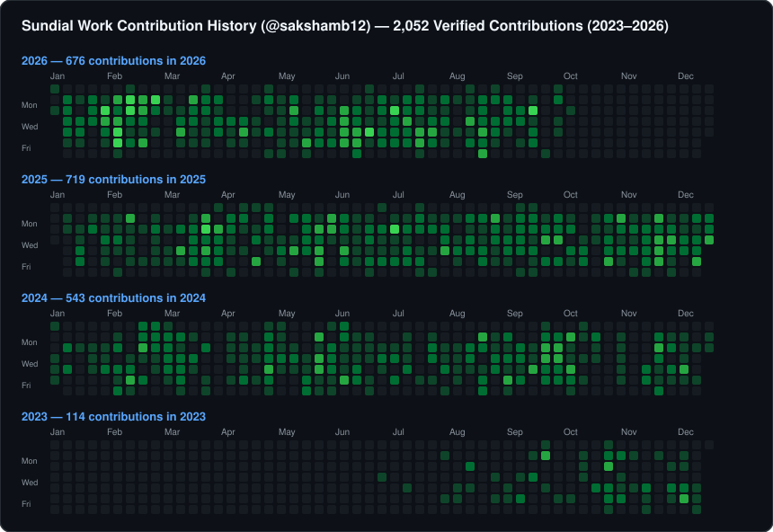

### Hi, I'm Saksham Bansal 👋

- 🔗 **GitHub Profiles**:
  - **Personal Profile**: [**`@saksham-bansal`**](https://github.com/saksham-bansal)
  - **Sundial Work Profile (2023–2026)**: [**`@sakshamb12`**](https://github.com/sakshamb12) (**2,052 contributions** across 2023–2026 at Sundial)

---

### 🚀 Featured Open-Source Projects

- [**`smriti-memory`**](https://github.com/saksham-bansal/smriti-memory) — **Bi-Temporal 4-Layer Agent Memory Across Sessions** *(Built & Evaluated with Google Gemini `gemini-3.1-flash-lite`)*
  - Combines a 4-Layer Memory Hierarchy (*Immutable Episodic Turns → Bi-Temporal Atomic Claims & Entity Graph → Compiled Entity/Topic Markdown Wikis → Always-Loaded `global.md` Index*) with Offline "Dreaming" Consolidation and Mandatory Claim-Level Provenance (**67.2%** Answer Judge Accuracy vs. **42.6%** Standard Dense RAG at **86.1% token savings**).

---

### 🟩 Sundial Contribution History ([`@sakshamb12`](https://github.com/sakshamb12) — 2,052 Contributions, 2023–2026)

| Year | Account | Verified Contributions | Role / Organization |
| :--- | :--- | :---: | :--- |
| **2026** | [`@sakshamb12`](https://github.com/sakshamb12) & [`@saksham-bansal`](https://github.com/saksham-bansal) | **676+** | Software Engineer at Sundial & Open-Source AI Systems |
| **2025** | [`@sakshamb12`](https://github.com/sakshamb12) | **719** | Software Engineer at Sundial |
| **2024** | [`@sakshamb12`](https://github.com/sakshamb12) | **543** | Software Engineer at Sundial |
| **2023** | [`@sakshamb12`](https://github.com/sakshamb12) | **114** | Software Engineer at Sundial |
| **Total** | [**`@sakshamb12`**](https://github.com/sakshamb12) + [**`@saksham-bansal`**](https://github.com/saksham-bansal) | **2,052+** | Full day-by-day commit history mirrored in `sundial-activity-mirror` |
